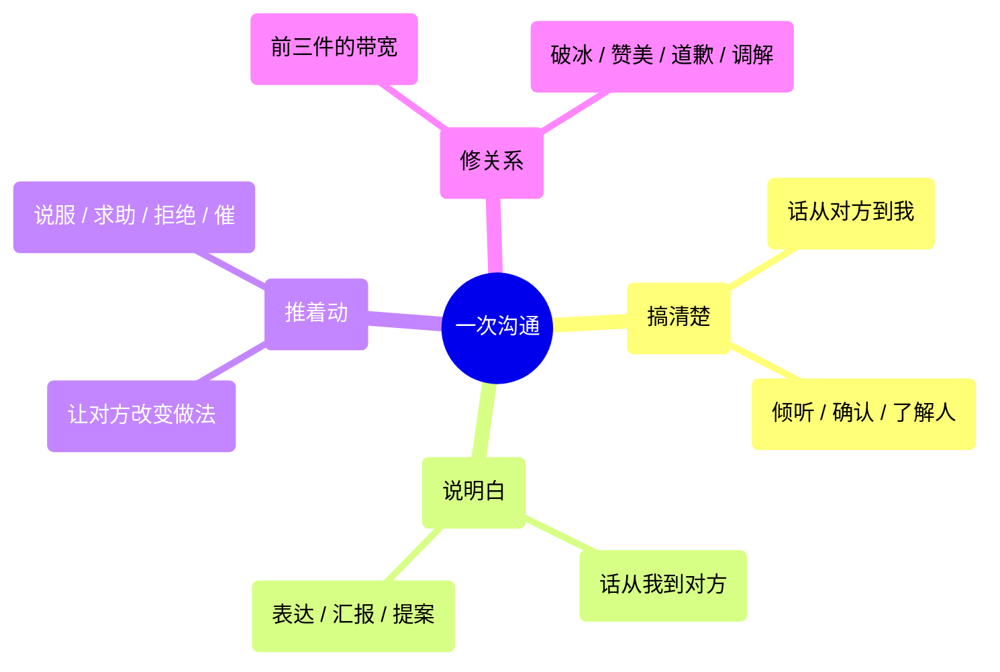

# 0. 怎么用这本手册

## 0.1 三秒导航

事情来了，先问自己一句：**我现在最缺的是什么？**

| 我现在最缺 | 说明 | 翻到 |
|---|---|---|
| 缺信息 | 我还没搞懂对方到底要什么 | [第 2 章 搞清楚](02_搞清楚_V1_2026-11-01.md#h-37005d842f1f) |
| 缺表达 | 我懂，但说不明白 | [第 3 章 说明白](03_说明白_V1_2026-11-01.md#h-bbd3d64b80b0) |
| 缺推力 | 说明白了，对方不动 | [第 4 章 推着动](04_推着动_V1_2026-11-01.md#h-a48397e897b7) |
| 缺关系 | 说什么对方都拧着来 | [第 5 章 修关系](05_修关系_V1_2026-11-01.md#h-98913c3937d0) |
| 缺一次反馈 | 我要评价别人、或者教别人 | [第 6 章 给反馈](06_给反馈_V1_2026-11-01.md#h-757dddddd94c) |
| 正在着火 | 延期了 / 变更了 / 背锅了 / 推不动 | [第 7 章 麻烦现场](07_麻烦现场_V1_2026-11-01.md#h-08847f603e94) |
| 什么都不缺 | 不着急，想平时练一练 | [第 9 章 怎么练](09_怎么练_V1_2026-11-01.md#h-6d40f166bed3) |

## 0.2 处境速查表（最常用的翻这里）

**正在着火（第 7 章）**

| 我的处境 | 翻到 |
|---|---|
| 项目要延期了，得告诉领导 | [7.1 延期了](07_麻烦现场_V1_2026-11-01.md#h-6f90a946c342) |
| 临近上线发现需求文档不清，开发要延期 | [7.2 文档不清导致延期](07_麻烦现场_V1_2026-11-01.md#h-ffe5cdf9205e) |
| 这次交付不完整，怕丢信任 | [7.3 交付不完整](07_麻烦现场_V1_2026-11-01.md#h-baf4889fa3f6) |
| 客户老改需求 | [7.4 客户老改需求](07_麻烦现场_V1_2026-11-01.md#h-e713a7b93d49) |
| 上线后又要改，同事有怨气还吐槽我 | [7.5 上线后又要改](07_麻烦现场_V1_2026-11-01.md#h-aff6d107e75f) |
| 只做了重要功能，被嫌弃功能不全 | [7.6 只做了部分功能被嫌弃](07_麻烦现场_V1_2026-11-01.md#h-4950fcb54925) |
| 领导要第一版就做到完美 | [7.7 领导要第一版就完美](07_麻烦现场_V1_2026-11-01.md#h-411ddec1ebd4) |
| 测试慢，可能交付不了 | [7.8 测试推不动](07_麻烦现场_V1_2026-11-01.md#h-d5237aafcc4f) |
| 别的部门不配合我录数据 | [7.9 跨部门推不动](07_麻烦现场_V1_2026-11-01.md#h-ce6374924c07) |
| 领导迟迟不拍板 | [7.10 领导不拍板](07_麻烦现场_V1_2026-11-01.md#h-53b0a45a52ad) |
| 领导老问我职责外的事 | [7.11 领导老问我职责外的事](07_麻烦现场_V1_2026-11-01.md#h-4fb955493214) |
| 领导只挑刺，从不夸 | [7.12 领导只挑刺](07_麻烦现场_V1_2026-11-01.md#h-d1f28b51dad8) |
| 领导施压，要更快更好 | [7.13 领导施压](07_麻烦现场_V1_2026-11-01.md#h-db64d6031e82) |
| 领导说话很有攻击性 | [7.14 攻击性领导](07_麻烦现场_V1_2026-11-01.md#h-75ab5337d582) |
| 领导甩来一个数据问题，要测试排查 | [7.15 领导甩来一个数据问题](07_麻烦现场_V1_2026-11-01.md#h-d36340448785) |
| 发版时间和节假日/特殊任务撞车 | [7.16 发版时间撞车](07_麻烦现场_V1_2026-11-01.md#h-7e6ede611769) |
| 要跟高层讲用户体验为什么重要 | [7.17 向高层讲用户体验的价值](07_麻烦现场_V1_2026-11-01.md#h-081d0388b411) |
| 和开发吵了一架（需求没写清） | [7.18 需求没写清被质问](07_麻烦现场_V1_2026-11-01.md#h-91536cba13da) |
| 上线时间不是我定的，但上面说不合理 | [7.19 锅不是我的但落我头上](07_麻烦现场_V1_2026-11-01.md#h-2c0b3d47fd32) |
| 反复紧急发版，团队被质疑质量差 | [7.20 反复紧急发版导致团队被质疑](07_麻烦现场_V1_2026-11-01.md#h-db9d86f92e38) |
| 手里一堆需求，各方都在催 | [7.21 多头催我](07_麻烦现场_V1_2026-11-01.md#h-6819a363563c) |
| 队友不专业，怎么配合 | [7.22 队友不靠谱](07_麻烦现场_V1_2026-11-01.md#h-4087c8e87026) |
| 不想接手某个岗位 | [7.23 不想接这个岗位](07_麻烦现场_V1_2026-11-01.md#h-cfdf8db190a6) |
| 想把职责外的事高情商推出去 | [7.24 把职责外的事推出去](07_麻烦现场_V1_2026-11-01.md#h-760a4089a6b0) |

**日常动作**

| 我要做的事 | 翻到 |
|---|---|
| 跟领导汇报进展 | [3.2 汇报](03_说明白_V1_2026-11-01.md#h-cd7c11addaa7) |
| 请领导拍板一件事 | [3.3 提案 / 请示](03_说明白_V1_2026-11-01.md#h-19f2841030e6) |
| 在评审会上讲方案 | [3.4 需求评审](03_说明白_V1_2026-11-01.md#h-9be16c4f667b) |
| 临时被点名发言 | [3.5 即兴发言](03_说明白_V1_2026-11-01.md#h-eaff8b33a664) |
| 写晋升答辩 | [3.6 晋升答辩](03_说明白_V1_2026-11-01.md#h-53254cb03c80) |
| 说服别人 | [4.2 说服](04_推着动_V1_2026-11-01.md#h-3601615196d6) |
| 求人帮忙 | [4.3 请求帮助](04_推着动_V1_2026-11-01.md#h-5e4cef440fef) |
| 拒绝一个需求 | [4.4 拒绝](04_推着动_V1_2026-11-01.md#h-fdcae3c72a5b) |
| 催进度 | [4.5 催办推进](04_推着动_V1_2026-11-01.md#h-6a097f116121) |
| 管理排期预期 | [4.6 管理预期](04_推着动_V1_2026-11-01.md#h-35f15eab4cf9) |
| 让沟通落到行动上 / 交代任务 | [4.7 导向行动](04_推着动_V1_2026-11-01.md#h-cf01ea08b62d) |
| 跟对方建立共识 / 把专业内容讲给外行 | [2.4 创造共识](02_搞清楚_V1_2026-11-01.md#h-51449b6a764a) |
| 跟新同事/新领导第一次打交道 | [5.1 破冰](05_修关系_V1_2026-11-01.md#h-172b577a337b) |
| 道歉 | [5.6 道歉](05_修关系_V1_2026-11-01.md#h-f91dc70a4937) |
| 调解两个人的矛盾 | [5.7 调解矛盾](05_修关系_V1_2026-11-01.md#h-2d4de693effb) |
| 批评下属 | [6.2 批评](06_给反馈_V1_2026-11-01.md#h-c3b7f74a58b9) |
| 给领导提意见 | [6.3 提意见](06_给反馈_V1_2026-11-01.md#h-3d549c1ca2e1) |
| 辅导新人 | [6.4 辅导](06_给反馈_V1_2026-11-01.md#h-81098ed9ec43) |
| 做绩效谈话 | [6.5 绩效谈话](06_给反馈_V1_2026-11-01.md#h-d8f031cc0a7d) |
| 主持一个会 | [6.6 主持会议](06_给反馈_V1_2026-11-01.md#h-53faf86d8e27) |
| 忘了某个模型是什么 | [附录 A 模型速查卡](附录A_模型速查卡_V1_2026-11-01.md#h-210b6434308c) |
| 想找个 AI 提示词 | [附录 B AI 提示词库](附录B_AI提示词库_V1_2026-11-01.md#h-c2de3a27d0e9) |
| 不着急，想平时练一练 | [第 9 章 怎么练](09_怎么练_V1_2026-11-01.md#h-6d40f166bed3) |

## 0.3 这本书的四个筐

一次沟通，剥到最底，只干四件事：

**关系是带宽。** 带宽不够，前三件全部做不成。所以关系不是"额外的社交"，是基础设施。

---

<!-- book-navigation -->

---

[上一章](README.md) · [目录](SUMMARY.md) · [下一章](01_开口前的判断_V1_2026-11-01.md)
